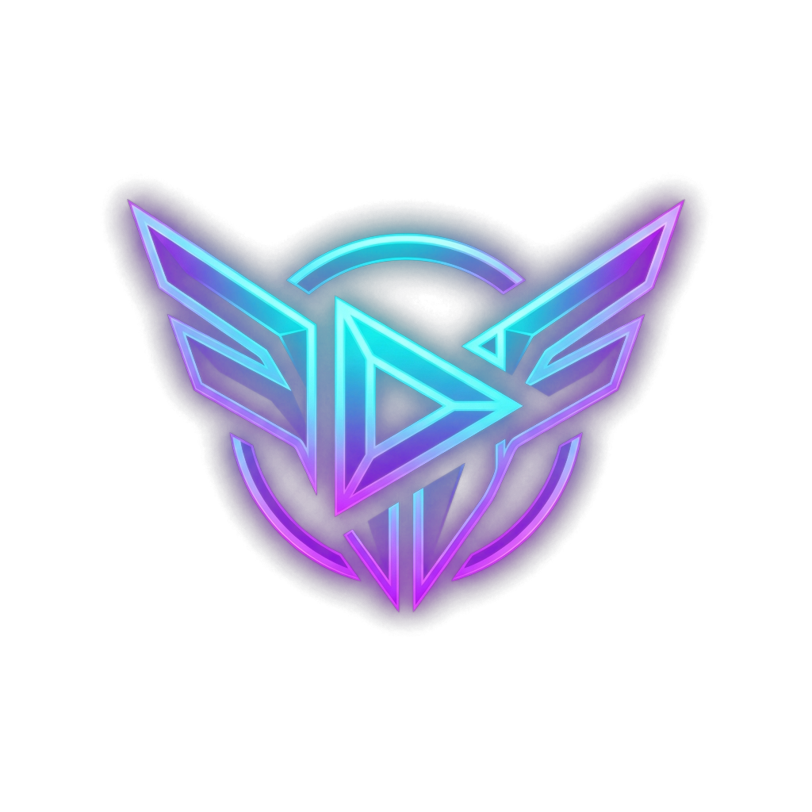
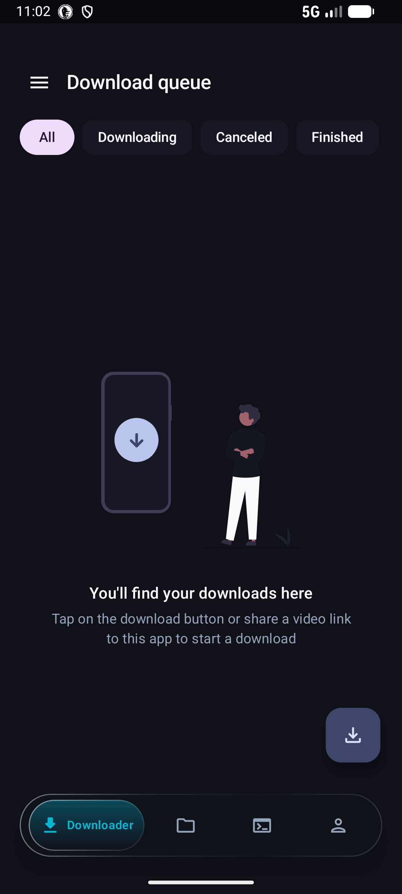
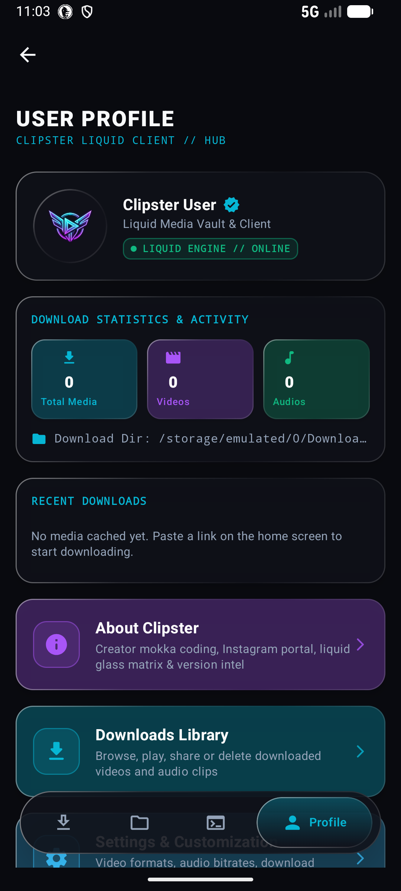
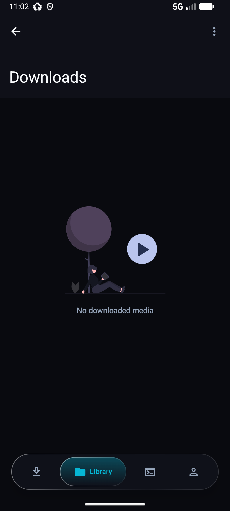
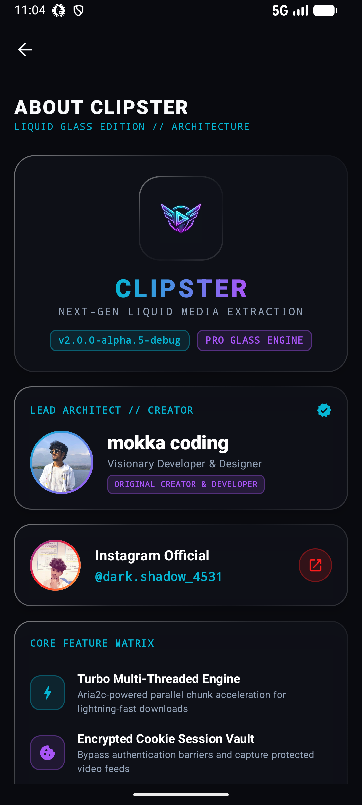
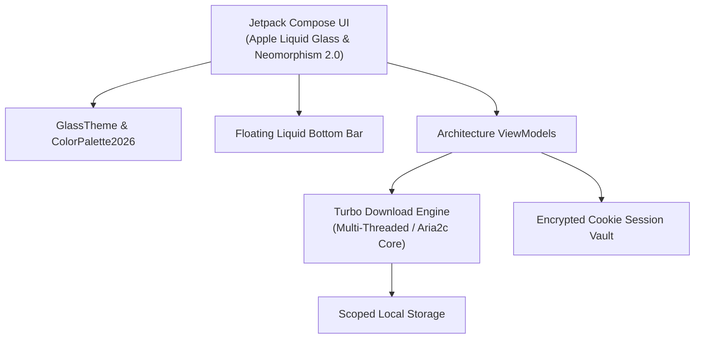

<div align="center">

  

  # 💎 CLIPSTER
  ### Next-Gen Apple Liquid Glass & Neomorphism 2.0 Media Vault

  <p align="center">
    <a href="https://git.io/typing-svg">
      
    </a>
  </p>

  <p align="center">
    <a href="https://android.com"></a>
    <a href="https://kotlinlang.org"></a>
    <a href="#"></a>
    <a href="https://www.instagram.com/dark.shadow_4531"></a>
    <a href="LICENSE"></a>
  </p>

</div>

---

## 🌌 Overview

**Clipster** is an advanced open-source media client and video creation suite designed for Android. Developed by **mokka coding** (@dark.shadow_4531), Clipster combines the tactile realism of **Apple Liquid Glass & Neomorphism 2.0** with a high-throughput multi-threaded extraction engine.

Whether capturing cinematic Instagram reels, full-length audio tracks, or high-bitrate video clips, Clipster renders every interaction with translucent frosted optics, specular highlights, and fluid physics — with a built-in vertical Reel Viewer and on-device Video Editing Studio.

---

## ✨ Visual Showcase

<div align="center">
  <table>
    <tr>
      <td align="center" width="50%">
        <b>🏠 Downloader & Floating Liquid Navbar</b><br/><br/>
        
      </td>
      <td align="center" width="50%">
        <b>👤 User Profile Hub & Telemetry</b><br/><br/>
        
      </td>
    </tr>
    <tr>
      <td align="center" width="50%">
        <b>📂 Downloads Library</b><br/><br/>
        
      </td>
      <td align="center" width="50%">
        <b>🚀 Lead Architect Spotlight</b><br/><br/>
        
      </td>
    </tr>
  </table>
</div>

---

## ⚡ Core Highlights

### 🎬 1. Built-in Vertical Reel Viewer & Player (Exclusive)
* **Instagram Reels Style In-App Player**: Vertical swipeable full-screen playback powered by Android Media3 ExoPlayer.
* **Zero External Dependencies**: No need for VLC, MX Player, or gallery apps. Play downloaded reels instantly inside Clipster.
* **Immersive Gestures**: Tap to play/pause with animated specular badge, double-tap heart like animation, and timeline scrubber.
* **Side Glass Control Dock**: Instant 1-tap mute, loop repetition, aspect ratio toggle (Fit vs Fill/Zoom), and system share sheet.

### ✂️ 2. Integrated Video Studio & Editing Suite
* **Precision Video Trimming**: Custom range slider for millisecond-accurate video cuts.
* **Aspect Ratio Formatter**: 9:16 (Reel/Story), 1:1 (Square), 16:9 (Landscape), and 4:5 (Portrait) presets.
* **Branding & Watermark**: Custom text watermark overlays (e.g. `@dark.shadow_4531`) with positioning controls.
* **Audio Engineering**: Strip audio for silent reels or preserve high-fidelity soundtrack.
* **Variable Speed Engine**: 0.5x slow-mo, 1.0x, 1.25x, 1.5x, and 2.0x playback acceleration.
* **Hardware-Accelerated Render**: Media3 Transformer pipeline for fast on-device export and automatic library indexing.

### 💎 3. Apple Liquid Glass & Neomorphism 2.0
* **Translucent Obsidian Glass**: Deep, refracted glass surfaces layered with dual-directional light physics.
* **Floating Liquid Bottom Navigation Bar**: Signature pill capsule with dynamic spring-animated expanding tabs and zero touch latency.
* **Tactile Spring Physics**: High-response haptic and visual spring dampening on every card, button, and gesture.
* **2026 Luxury Color Palette**: Titanium Obsidian, Hi-Res Cyan, Dolby Atmos Purple, and Lossless Emerald.

### 🚀 2. Proprietary Social Stream Pipeline
* **Instagram Video & Reel Extraction**: Purpose-built extraction protocols handling dynamic video streams, private session tokens, and audio isolation.
* **Encrypted Cookie Vault**: Securely inject authentication cookies to download restricted or personal collection media without cloud logging.
* **Parallel Chunk Accelerator**: Multi-threaded segmentation utilizing native core routines for blazing downloads.

### 🛡️ 3. Privacy & Zero-Telemetry Architecture
* **100% On-Device**: No analytics, no third-party trackers, no cloud data harvesting.
* **Local Sandboxing**: Credentials, history, and metadata remain strictly inside your device's protected storage.

---

## 📱 Navigation Architecture

Clipster features a 4-tier floating navigation architecture:

| Destination | Route | Description |
| :--- | :--- | :--- |
| **Downloader** | `Route.HOME` | Central download hub with intelligent clipboard auto-detection |
| **Library** | `Route.DOWNLOADS` | Media vault for browsing, playing, and sharing saved clips |
| **Tasks** | `Route.TASK_LIST` | Multi-process download manager and scheduler |
| **Profile** | `Route.PROFILE` | User stats, liquid engine status, and creator portal |

---

## 🛠️ Technology Stack



* **Framework:** Jetpack Compose (Declarative UI)
* **Language:** Kotlin 2.x
* **Asynchronous Runtime:** Kotlin Coroutines & Flows
* **Graphics & Shaders:** Jetpack Compose Canvas, Custom Glass Modifiers, RenderEffects
* **Architecture:** Unidirectional Data Flow (MVI / MVVM)

---

## 🏗️ Building from Source

### Prerequisites
* **Android Studio Ladybug / Meerkat** (or newer)
* **JDK 21**
* **Android SDK API 36**

```bash
# Clone the repository
git clone https://github.com/keerthan4531-a11y/clipster.git
cd clipster

# Build Debug APK
./gradlew assembleGithubPreviewDebug
```

The generated APK will be available under:
`app/build/outputs/apk/githubPreview/debug/`

---

## 👨‍💻 Lead Architect & Creator

<div align="center">

  **mokka coding**  
  *Visionary Developer & Designer*

  [](https://www.instagram.com/dark.shadow_4531)

</div>

---

## 📄 License

```
Copyright (C) 2026 mokka coding (keerthan4531-a11y)

This program is free software: you can redistribute it and/or modify
it under the terms of the GNU General Public License as published by
the Free Software Foundation, either version 3 of the License, or
(at your option) any later version.

This program is distributed in the hope that it will be useful,
but WITHOUT ANY WARRANTY; without even the implied warranty of
MERCHANTABILITY or FITNESS FOR A PARTICULAR PURPOSE. See the
GNU General Public License for more details.
```
